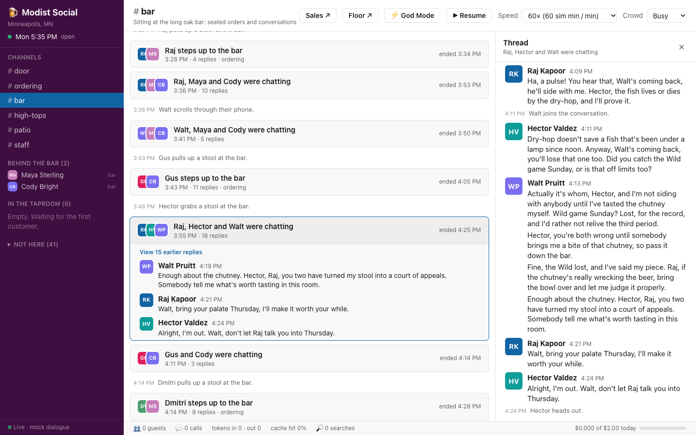
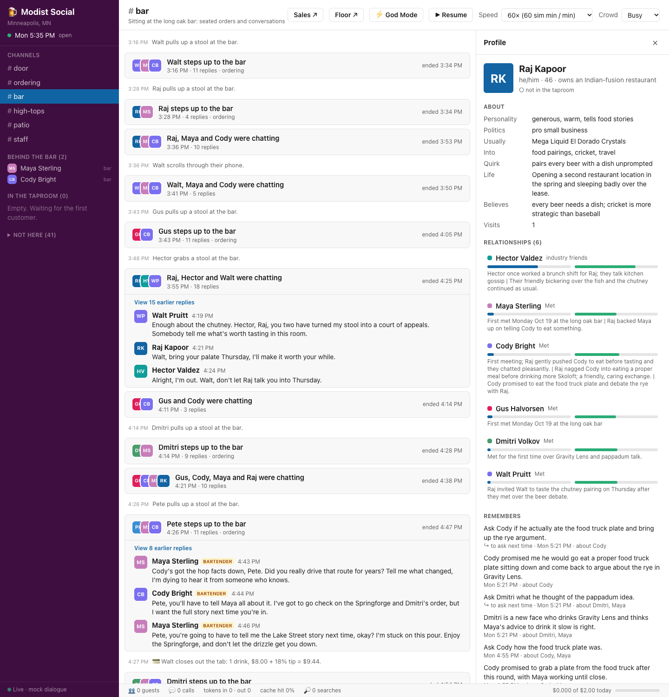
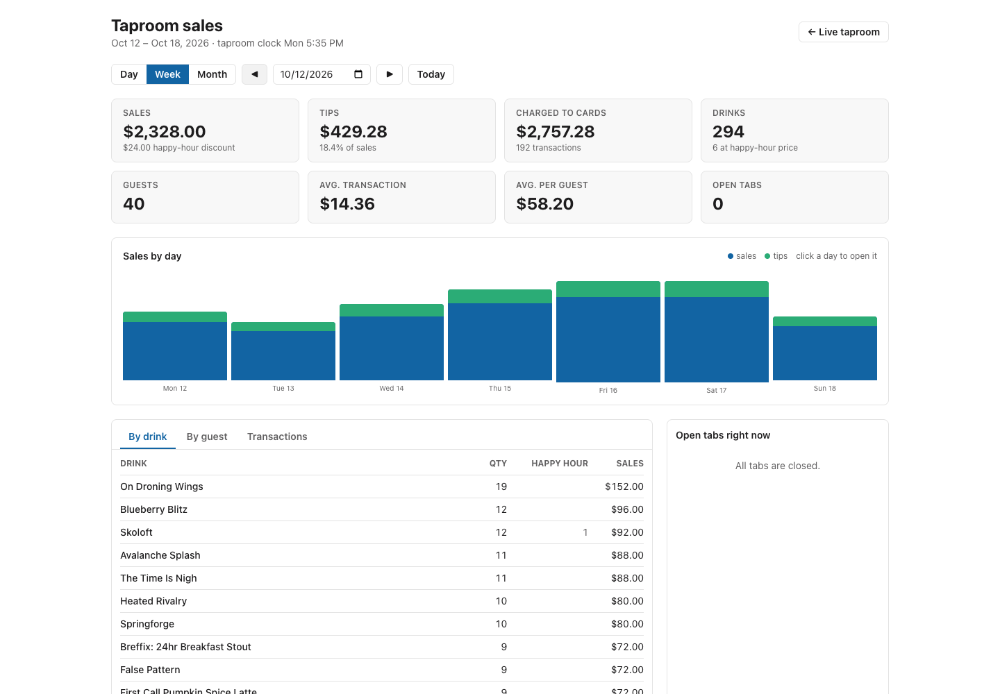

# Modist Social

A social experiment: a virtual craft-brewery taproom populated by 40 AI patrons, 5 AI bartenders, and new people who walk in off the street (up to 150 patrons in all), each played by Claude Haiku. They come and go through the day and week, strike up conversations (beer, brewing, politics, local events, gossip), form relationships, and remember each other. You watch it live in a Slack-style web UI.



The point of the experiment is that the people feel like people: each has a personality, a life, a mood that changes through the night, and a memory of who they have met and what was said. See [The people](#the-people).

## Run it

Requirements: Docker (for Postgres), [uv](https://docs.astral.sh/uv/), Node 22+, and an Anthropic API key.

The app runs locally; Docker only provides the database. Everything is wrapped in `make`:

```bash
make dev      # sets everything up on first run, then starts Postgres + backend (:8000) + UI (:5173)
```

The first run creates `.env` and starts paused with a banner: add your `ANTHROPIC_API_KEY` to `.env` and run `make dev` again (or try `make mock` first). Ctrl+C stops the app.

Run `make` to list all commands: `setup` (also run by `dev`), `mock` (canned dialogue, no API calls), `backend` / `ui` (run one in its own terminal), `stop`, `reset` (wipe all data), `test`, `full` (everything in containers).

Open http://localhost:5173. Whenever the app starts while the taproom is closed, the clock skips ahead to 10 simulated minutes before the next opening (a restart during open hours resumes where it left off); at the default speed (1 real minute = 15 sim minutes) the first guest walks in within a minute or two.

No key yet? `make mock` runs the whole flow for free with canned dialogue.

Postgres data lives in a Docker volume, so relationships and memories survive restarts. `make reset` wipes everything for a fresh brewery.

## What you see

- **#door**: arrivals, departures, shift changes, last call, and the daily "around town" news.
- **#ordering**: walk-up orders at the end of the bar, one short card per drink.
- **#bar**: guests sitting on the 20 stools. They order from their seat, chat with the bartenders and talk to their stool neighbours.
- **#inside-tables, #patio**: each conversation group is a thread card with a live preview and typing indicator. Click one for the full transcript.
- **#staff**: bartenders talking shop when the bar is quiet.
- Click any name or avatar for a profile: personality, relationships (familiarity and affinity bars), and what they remember.
- Header: pause/resume, speed (5x to 240x) and crowd (Quiet / Normal / Busy / Packed). Footer: guests, calls, tokens, prompt-cache hit rate, web searches, and spend against the daily budget.

### Time, speed and crowd
Everything runs on the simulated clock (arrivals, how long people stay, drinks per visit, happy hour), and sales are recorded by sim day. Three separate knobs:
- **Speed** only changes how fast you watch. Model calls take real seconds, so at high speeds a spoken line would cost many sim minutes and the day would go sparse. A pace governor holds the clock back (the header shows "held to N×") so conversation per sim hour looks the same at any speed.
- **Crowd** is the way to get more guests and conversations. It scales arrivals and chat, so extra sales come from extra people, like a busy night. Days run off Normal are tagged on the sales dashboard.
- **Closed hours** are skipped once the last guest has left: the clock jumps to 10 minutes before the next opening.

### God Mode
The **⚡ God Mode** button in the header lets you drop a free-form event into the room ("the stock market crashed today", "the local team won the championship"). Press *Read the room* to see how it lands, adjust if you disagree, then press *Set the mood*.
- **Two scales, 1-5.** *Reach* is how many people care (a regular-season game: only the fans; a championship or a crash: everyone). *Divisiveness* is how much they split into sides (a crash: everyone is worried together; a war or a culture-war issue: people pick sides). In live mode one cheap model call scores the event, names the two sides, and says where each person lands from their job, politics and interests. In `make mock` a keyword estimate does it for free.
- **Reach** sets the chance a new chat is about it, and low-reach events mostly only interest the people with a stake. Chats about it run longer.
- **Divisiveness** sets how the room splits: low means most people feel the same way, high means two real camps, with fewer people on the fence.
- **Heat** (reach and divisiveness together) sets the tone, from light chatter to raised voices. A hot story spills into chats that were about something else, and the bartenders stay neutral.
- **Escalation.** When people on opposite sides of a divisive event talk, tension builds. A bartender asks everyone to keep it friendly, then someone storms off to another spot (or, rarely, gets sent outside). Those arguments hurt how the two people feel about each other.
- **Decay.** The buzz fades over sim time: a passing remark is forgotten within hours, a crash lingers for days. It turns itself off once it has faded, and *Turn off* ends it immediately. What people already said and remembered stays in their memories.
- The event is saved, so it survives a restart. In `make mock` the canned lines react to it so you can see it work for free.

## The people

Everyone in the taproom is built to behave like a person rather than a chatbot. The model writes each line, but the state that shapes it (mood, energy, memory, who likes whom) lives in code and changes what happens, not only what is said.



### Who they are
Each person has a Big Five personality profile, a job, a life situation (a second location to open, a kid starting school), opinions they hold firmly, topics they steer away from, a conversation style (listener, storyteller, joker, debater or asker), speech habits, and how much they know about beer. These come from `backend/app/seed/patrons.yaml`. Each visit also has a reason: unwinding, catching up with friends, a quiet night alone, the game, a date. Personality is more than flavor text: quiet people tire sooner, agreeable people take longer to wind up in an argument, and open people are readier to talk about big news.

### How they feel tonight
During a visit each person carries a few moving numbers (`backend/app/sim/human.py`):
- **Mood** drifts with how chats go, and settles back over time.
- **Buzz** builds with each drink and wears off. A few in, people get looser and chattier, and may repeat a story.
- **Social battery** drains as they talk (faster for the reserved) and recovers when they are left alone.
- **Needs** such as the restroom, a phone call, some air, or a bite from the food truck.

These change behaviour. They decide who joins or starts a chat, who speaks next, how fast people reply, and who escalates an argument. A tired or irritable person, or one with a need, *excuses themselves* from a chat and stays in the taproom (you can see Sophie and Silas do it in the thread above). Solo guests scroll their phone or watch the game and turn down invitations. Each line also carries a private thought (shown in the profile, never said aloud) and a mood tag that feeds back into their state.

### How they sound
Each turn is rolled as a quick reaction, a normal line, or a short story, depending on style, buzz, energy and mood. Now and then there is a human slip: mishearing, a distracted answer, a joke that doesn't land, a trailing off. The style rules in `backend/app/seed/world.md` list the tells of an assistant to avoid ("Great point", a question at the end of every line, repeating back what was just said, neat summing-up) and give good and bad examples.

### What they remember
- When a conversation ends, one cheap call records what each person remembers, how much it mattered, and sometimes one thing to ask about next time. Follow-ups come up once, then are retired.
- A first meeting between two strangers is always recorded, even when the chat was too short to summarize: a memory for each side and the day they met.
- Each turn recalls up to 20 memories, scored by recency, importance and relevance (who is in the room, what is being said), and shown with when they happened ("last Thursday"). Memories about third parties resurface later, which is how gossip spreads.
- After closing, each person who visited reflects on the day, and their "life lately" moves on a little. That shows up in the profile and in later conversations.

### Life between visits
- Each sim day every patron has roughly a one-in-eight chance that something happens away from the taproom: a work crunch, a sick kid, a car repair, a promotion, a new puppy. About 35 kinds are defined in `backend/app/seed/life_events.yaml`, and some are arcs (a job interview becomes a job offer or a rejection a few days later; a doctor's appointment becomes an all-clear or a scare).
- It is rolled by code, not the model, and it changes behavior while it lasts, fading as the days pass: how likely they are to come in, how long they stay, how much they drink, the mood they arrive in, why they came, and whether they put drinks on a card instead of a tab.
- They carry it into the room: a line about it goes in their scene ("on your mind lately"), it is saved as a memory, and the nightly reflection builds on it. Each new event gets one tiny model call to add a concrete detail; if that fails or reads badly the plain template text is used. In mock mode the template is always used.
- See a person's recent events under "Off-screen" in their profile. The realism scorecard shows how often people actually bring theirs up.

### Relationships
Every pair has familiarity and affinity, and both move after conversations (arguments hurt). Liking matters: people drift toward people they like and away from people they can't stand. Regulars greet friends they haven't seen in days, bartenders know the usual, and friends tend to follow each other in.

### Evolving relationships
- On top of the two numbers, every pair has a **bond** that forms and changes over weeks: acquaintances, friends, close friends, rivals, a crush, a couple, a falling-out, exes, a mentor. The rules are in `backend/app/sim/bonds.py` and run in code; seeded pairs get a starting bond from their kind and numbers, so no `make reset` is needed.
- Each finished conversation's existing summary call also reports an optional "moment" for each pair (a fight, flirting, an apology, confiding, advice, teasing). That adds a few output tokens and no new call. Mock mode emits moments too.
- Bonds change behavior: couples and close friends follow each other in, rivals seek each other out to needle each other, people in a falling-out (and exes, for a week) avoid each other, and the scene gives each person one line about how they feel ("you have a quiet crush on Sam"). A crush is private: only the one with the feelings is told.
- Things happen between visits too: a falling-out heals or sets hard after a week or two, a crush fades, couples sometimes come in for a night out, and an off-screen argument can become a real falling-out with someone close. Romance is open to any adult patron pair but rare, and people whose persona says they are with someone catch feelings far less often. At most one crush or couple forms per sim day.
- See a person's bond badges and recent changes in their profile. The realism scorecard has a Relationships card that flags a room where nothing ever changes or everything does.

### New faces
Now and then a stranger walks in (about 8 a week by default, scaled by the Crowd setting, up to 150 patrons in total). They are generated on the spot: code rolls the name (never one already taken), age, personality scores, schedule and habits, and in live mode one small Haiku call writes the rest (job, opinions, quirks, how they talk, where their life stands and what brought them here). `make mock` builds them from the pools in `backend/app/seed/newcomer_pools.yaml` for free. They are saved like the 40 and tracked the same way: memories, relationships, a tab, mood, reflections, a profile, and a count of visits. They keep their own visit schedule, so they can come back, and a few arrive with a friend who is already there. Bartenders welcome a first-timer with a taster, and a new face is tagged "new" in the sidebar until their second visit. Tune with `NEWCOMERS_ENABLED`, `NEWCOMERS_PER_WEEK` and `MAX_PATRONS` in `.env`.

### The room
Weather, a game on the bar TV in season (with a running score that cheers or annoys the fans), trivia on Wednesday evenings, and how loud it is. All of it is deterministic from the date, and people mention it.

## How it works

A deterministic Python **director** runs the world. The LLM is only asked for one person's next line, or a short memory summary, so orchestration costs no tokens.

- **People**: who they are and how they behave is covered in [The people](#the-people).
- **Time**: an accelerated, pausable clock. Mon-Wed 3-10pm, Thu 3-11pm, Fri 2pm-12am, Sat 11am-12am, Sun 11am-9pm. Last call 30 minutes before close.
- **Bartenders**: five of them, always working in pairs, on a fixed weekly roster (`backend/app/sim/schedule.py`).
- **Arrivals**: each patron has a visit frequency, preferred days and hours (`backend/app/seed/patrons.yaml`). Friends tend to follow each other in. Visit rates are scaled up (`ARRIVAL_BOOST`) so a 40-person town feels busy.
- **At the bar**: guests either step up to order (in #ordering) or take a stool (20 of them, in #bar), depending on their personality and who's around. Each guest picks an area for the visit (bar, inside tables or patio): solo guests lean toward the bar, groups toward tables, the patio follows the season and weather, a game on the TV pulls fans to the bar, trivia pulls groups to the tables, and a crowded area is less attractive (`app/sim/seating.py`). Seated guests may stay to chat with one or both bartenders (who get pulled away to pour now and then), and strangers on neighbouring stools strike up conversations with each other.
- **Drinks and sales**: every drink is $8, paid by card. Sunday to Wednesday until 6pm, a random 4 of the 52 drinks are half price (the same 4 all day, new ones each day). Each guest wants about 1 to 3 drinks a visit, sometimes more. The bartender asks guests on a stool if they'd like another; everyone else walks up to the bar, then rejoins their group. Some guests pay per drink (one transaction each); others open a tab and close it out before leaving. Tips are 0%, 18%, 20% or 25%, depending on the guest's habit (`pay` and `tipper` in `patrons.yaml`).
- **Conversations**: each group is its own async task with randomized pauses between turns, so many conversations run side by side. People join, wander off, wave someone over, or head out. After finishing, a pair has a cooldown before talking again.
- **Web access**: once per sim day a "news desk" search pulls local headlines for `BREWERY_CITY`, shared with everyone. A patron can also ask to look something up mid-conversation (capped per sim hour).

## Sales dashboard



Open http://localhost:5173/sales (or "Sales ↗" in the header) for sales by day, week or month, updating live. Click a day in the chart to open it, a drink to see who bought it, or a guest to see what they bought. The Transactions tab lists every card charge with its drinks, tip and card; open tabs are listed on the side. Dates are the taproom's simulated calendar. Drinks count on the day they were poured, tips on the day the payment closed.

## Realism scorecard

Open http://localhost:5173/realism (or "Realism ↗" in the header) to see how human the room sounds, by day or week. It scores five things out of 100: fresh chat openers, phrase variety, distinct voices (do different people sound alike?), topic variety (including repeats of the last few days) and loose endings (chats that trail off rather than closing on a tidy goodbye). Below the scores are the openers and phrases the room keeps reusing, the topic mix, and which guests repeat themselves most.

The scorecard also feeds back into the dialogue: each turn's prompt ends with a short "don't reuse these phrases" list built from what that person and the room have said lately, and when too many chats end neatly, some are told to fizzle out instead. All of it is plain text statistics, with no extra model calls. Set `REALISM_FEEDBACK=false` to measure without the feedback.

## Keeping token use low

- Model `claude-haiku-5-5`, thinking off, `effort: low`, JSON output capped at 300 tokens.
- Prompt order is cache-friendly: shared world bible, then the person's persona (both with `cache_control`), then a small volatile scene (recent 10 lines, relevant memories, news). The footer shows the live cache-hit rate.
- A concurrency limit (`MAX_CONCURRENT_LLM`), a lookup cap, and a **daily budget guard** that pauses the sim and offers an "Add $1 and resume" button.

At the default pacing a full simulated day is on the order of a thousand short utterances, roughly 10 to 25 cents at Haiku 5.5 list prices (`price_*` in `backend/app/config.py`; adjust if prices change).

## Configuration (`.env`)

| Variable | Default | Meaning |
|---|---|---|
| `ANTHROPIC_API_KEY` | | required for live mode |
| `LLM_MODE` | `live` | `live` or `mock` |
| `DAILY_BUDGET_USD` | `2.00` | pause when today's spend reaches this |
| `BREWERY_CITY` | `Minneapolis, MN` | drives the news search |
| `SIM_SPEED` | `15` | sim minutes per real minute (also adjustable in the UI) |
| `WEB_SEARCH_ENABLED` | `true` | news desk and phone lookups |
| `MAX_CONCURRENT_LLM` | `3` | simultaneous API calls |
| `REALISM_FEEDBACK` | `true` | tell speakers which phrases and openers are worn out |

## Customizing the cast

Edit `backend/app/seed/` (`patrons.yaml`, `bartenders.yaml`, `relationships.yaml`, `world.md`). Persona edits for the existing people apply on restart; adding people or changing relationships needs `make reset`, which also wipes everyone who walked in. First names must be unique across everyone (walk-ins are checked against them, so new names go in `names.yaml` rather than clashing).

## What's next

I wasn't sure what to build next, so I asked an AI "what's next?" with one goal: make the sim more human. It came back with ten ranked ideas (a realism scorecard, life between visits, evolving relationships, drunkenness with consequences, and more). They are kept as-is in [docs/ai-planning.md](docs/ai-planning.md), and I'm using them as the roadmap.

## Development

```bash
make test                            # unit tests (clock, roster, prompts, live-client parsing)
```

Backend: FastAPI + SQLAlchemy (async) + Postgres, `app/sim` (director, clock, schedule), `app/agents` (prompts, turn building, memory), `app/llm` (live and mock clients, usage accounting). Frontend: React + Vite + Tailwind + Zustand, talking to `/api` and `/ws`.
