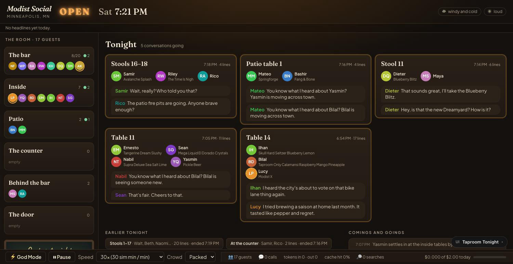
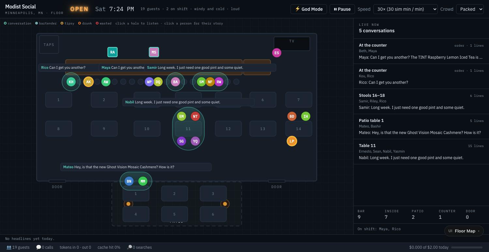
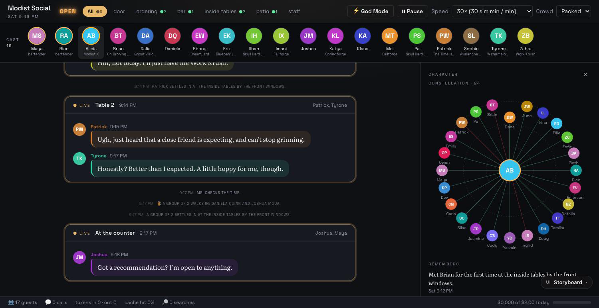
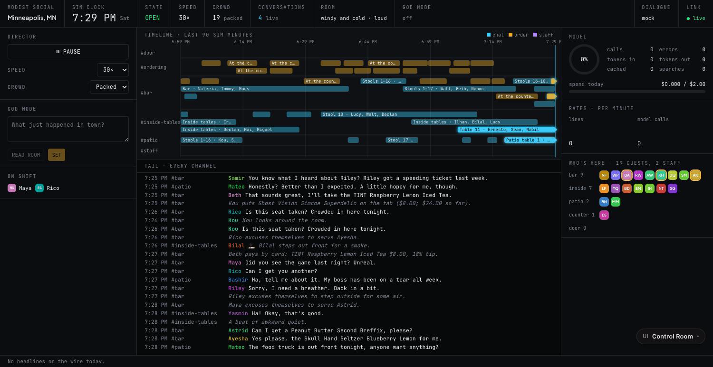

# UI explorations

The main page has four alternate layouts besides the Slack-style default. They are real React shells
wired to the same store and WebSocket, so each one runs on live data with `make mock` or `make dev`.
Pick one with the `ui` query parameter, or with the floating "UI" switch in the bottom-right corner,
which swaps layouts in place without reloading.

| Layout | URL | What it is for |
|---|---|---|
| Slack (default) | `/` | Channels, threads and a profile pane. Familiar and dense. |
| Taproom Tonight | `/?ui=tonight` | The simulation as a place. Neon OPEN sign, the day's headlines, weather, the game on TV and trivia night; the room's zones with who is in each; an on-tap chalkboard; every live conversation as a glowing card. |
| Floor Map | `/?ui=floor` | The room drawn to scale from the taproom layout. People sit where the sim puts them, each conversation is a halo you click to listen in, and the latest line floats above it. No WebGL. |
| Storyboard | `/?ui=storyboard` | The taproom as a script. A cast strip with buzz rings, dialogue panels in each speaker's color, stage directions, and a character sheet with a relationship constellation. |
| Control Room | `/?ui=control` | The director's console. A lane timeline of every conversation over the last 90 sim minutes, a merged log, inline God Mode gauges, model cost and cache telemetry with sparklines, and who is where. |

## How it fits together

- `frontend/src/skins/index.ts` is the registry. `SkinShell.tsx` reads the `ui` parameter, sets `data-skin` on `<html>` before first paint, and lazy-loads the chosen skin, so the default page downloads none of the skins' code, CSS or fonts.
- Each skin lives in `frontend/src/skins/<id>/` with its own CSS scoped under `html[data-skin="<id>"]`, overriding the same color variables the Slack components already use. That is why `Avatar`, `MessageRow`, `GodMode`, `Controls`, `StatsBar` and the profile pane work unchanged inside every skin.
- `frontend/src/skins/shared/` holds what the skins have in common: the picker, the news ticker, meters, sparklines, the neon sign, the transcript panel, and `useRoster` (who is where) and `useAllFeeds` (keep every channel loaded, not just the selected one).
- Fonts are self-hosted through `@fontsource` packages and bundled into each skin's chunk.
- Animation is CSS only. JavaScript animation loops stop when a tab is in the background, which froze an earlier version mid-transition.

## What the backend adds

All deterministic, no tokens, and all working in mock mode:

- The `clock` payload carries `room`: weather, room noise, trivia night, the song playing, and the game on TV with a live score. `backend/app/sim/environment.py` already computed all of it; it just never reached the UI.
- The daily headlines go out as a `news` WebSocket event when they change, so the ticker updates without a reload.
- `GET /api/menu` returns the board (name, style, ABV) for the chalkboard.
